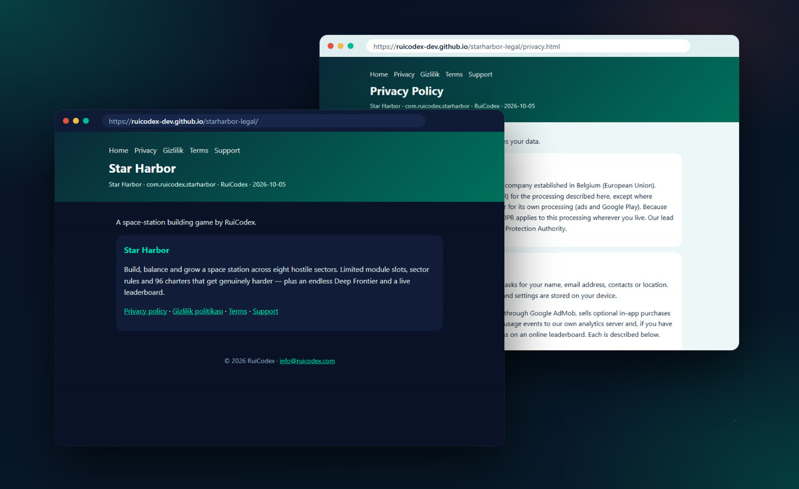
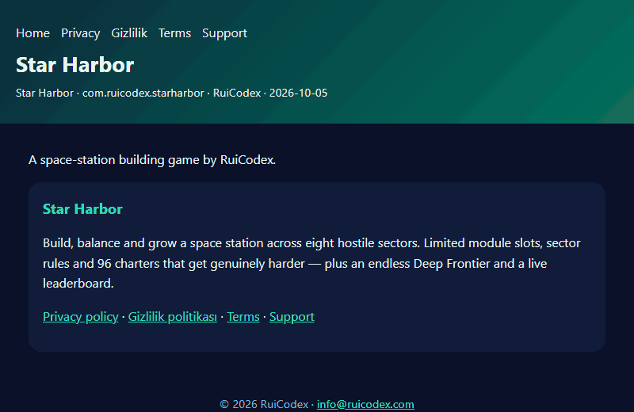
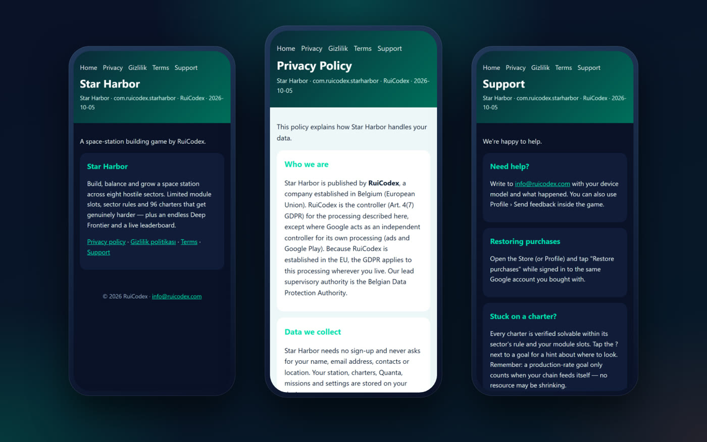
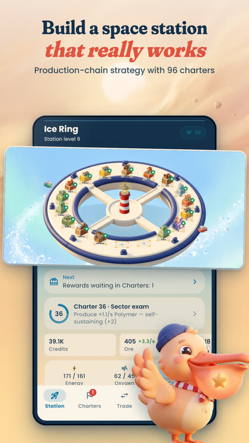
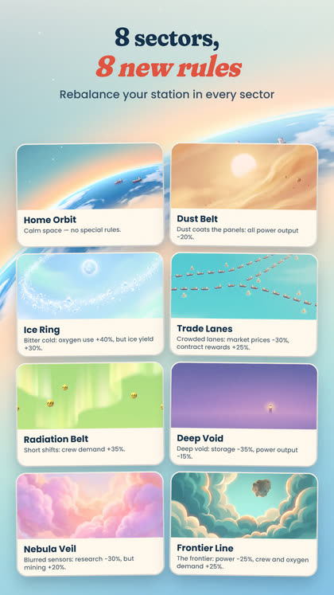
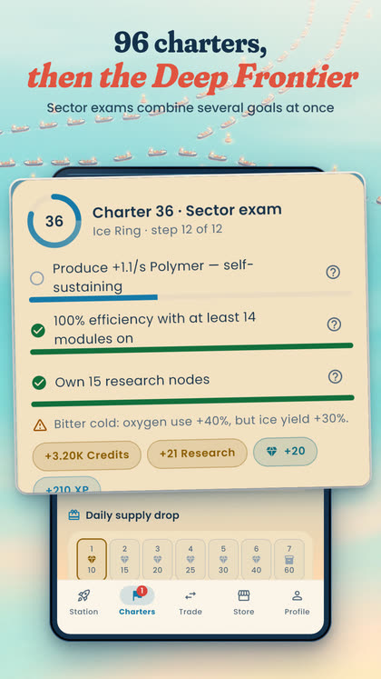
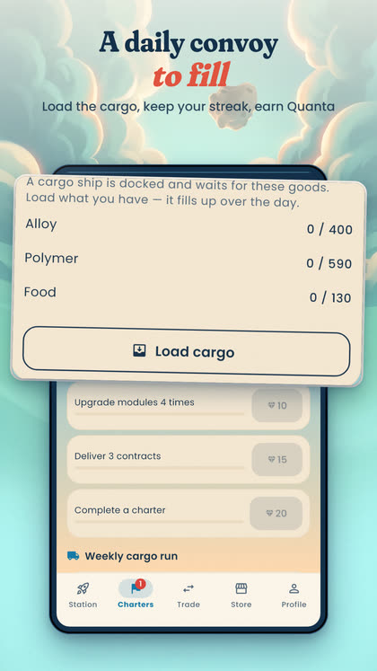
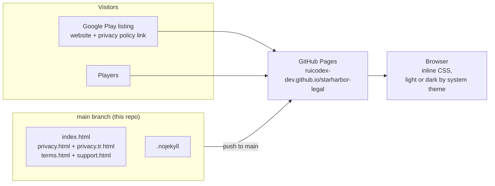

<div align="center">

<a href="https://ruicodex-dev.github.io/starharbor-legal/">
  <picture>
    
  </picture>
</a>

### The privacy, terms and support home of **Star Harbor: Space Station**, the space-station building game by Rui Codex.


**[Live site](https://ruicodex-dev.github.io/starharbor-legal/)** &nbsp;·&nbsp;
[Privacy](https://ruicodex-dev.github.io/starharbor-legal/privacy.html) &nbsp;·&nbsp;
[Gizlilik](https://ruicodex-dev.github.io/starharbor-legal/privacy.tr.html) &nbsp;·&nbsp;
[Terms](https://ruicodex-dev.github.io/starharbor-legal/terms.html) &nbsp;·&nbsp;
[Support](https://ruicodex-dev.github.io/starharbor-legal/support.html) &nbsp;·&nbsp;
[Get the game](https://play.google.com/store/apps/details?id=com.ruicodex.starharbor)

</div>

<br>

<p align="center">
  <a href="https://ruicodex-dev.github.io/starharbor-legal/">
    
  </a>
  <br>
  <sub>The live site: home in dark theme, the Privacy Policy in light theme. Real captures of ruicodex-dev.github.io/starharbor-legal.</sub>
</p>

## What this is

This repository **is** the website. Five hand-written, self-contained HTML pages are served by GitHub Pages straight from `main`.
They give [Star Harbor: Space Station](https://play.google.com/store/apps/details?id=com.ruicodex.starharbor) (`com.ruicodex.starharbor`)
a public home for the documents a store listing needs: a short landing page, the Privacy Policy in English and Turkish,
the Terms of Use and a Support page. The game's Google Play listing links here for its website and privacy policy.

<table>
  <tr>
    <td width="33%" valign="top">🔒 <b>GDPR first</b><br>Controller, legal bases (Art. 6), transfers (SCCs, Art. 46), rights and the Belgian Data Protection Authority, all on one page.</td>
    <td width="33%" valign="top">🇹🇷 <b>Turkish edition</b><br>A full Turkish privacy policy (<i>Gizlilik politikası</i>) that also covers KVKK Articles 9 and 11.</td>
    <td width="33%" valign="top">🧾 <b>Plain about data</b><br>Ads (AdMob), purchases (Google Play), the leaderboard and game analytics, each explained in its own section.</td>
  </tr>
  <tr>
    <td width="33%" valign="top">⚖️ <b>Consumer-safe terms</b><br>Virtual items, right of withdrawal, fair play, liability and Belgian law, with EU consumer protections spelled out.</td>
    <td width="33%" valign="top">🌗 <b>Light and dark</b><br>Follows <code>prefers-color-scheme</code> with one set of CSS custom properties per theme.</td>
    <td width="33%" valign="top">⚡ <b>Zero build, zero script</b><br>No framework, no JavaScript, no external fonts or trackers. Each page carries its own inline CSS.</td>
  </tr>
</table>

## The pages

| Page | File | What it covers |
|---|---|---|
| **Home** | [`index.html`](https://ruicodex-dev.github.io/starharbor-legal/index.html) | The game in one paragraph and links to every document |
| **Privacy Policy** | [`privacy.html`](https://ruicodex-dev.github.io/starharbor-legal/privacy.html) | Who we are, data collected, leaderboard, game analytics, ads, purchases, feedback, consent, children, legal bases, transfers, your rights |
| **Gizlilik politikası** | [`privacy.tr.html`](https://ruicodex-dev.github.io/starharbor-legal/privacy.tr.html) | The same policy in Turkish, including KVKK notes |
| **Terms of Use** | [`terms.html`](https://ruicodex-dev.github.io/starharbor-legal/terms.html) | The game, in-app purchases and withdrawal, leaderboard and fair play, liability, governing law and disputes |
| **Support** | [`support.html`](https://ruicodex-dev.github.io/starharbor-legal/support.html) | How to get help, restoring purchases, tips when a charter feels stuck |

<table>
  <tr>
    <td width="58%" valign="middle">
      
    </td>
    <td width="42%" valign="middle">
      <h3>Five pages, one header</h3>
      Every page shares the same header with links to Home, Privacy, Gizlilik, Terms and Support, and a meta line with the
      game name, the package id, the publisher and the date of the current version.
      <br><br>
      <b>Version 2.0 addendum:</b> purchase results in analytics events, an in-game switch for usage analytics,
      server-checked leaderboard updates and zero-charter entries left off the board.
    </td>
  </tr>
</table>

<details>
<summary><b>The privacy policy at a glance</b></summary>

What the published policy says, in short (the pages themselves are the authoritative text):

- **No sign-up.** The game never asks for a name, email address, contacts or location. Progress and settings stay on the device.
- **Leaderboard** on Rui Codex's own Appwrite server: an anonymous account per installation, a nickname and a few progress numbers. You can remove your entry in *Settings › Remove me from the leaderboard*.
- **Game analytics** on Rui Codex's own PostHog server, linked to a random on-device id, never the advertising ID. No session recording. Switch it off in *Settings › Usage analytics*.
- **Ads** through Google AdMob, with Google's consent form for players in the EEA, the UK and Switzerland. *Remove Ads* or the *Admiral Pass* turns off banner and interstitial ads.
- **Purchases** through Google Play; payment details are never seen by Rui Codex.
- **Children:** intended for players aged 13 and over; ads limited to the "G" content rating.
- **Your rights** under the GDPR (and KVKK for users in Türkiye), answered within one month, free of charge.

</details>

## On a phone

<p align="center">
  
  <br>
  <sub>Home, Privacy and Support at 390 × 844. Real captures of the live site.</sub>
</p>

## The game these pages cover

Star Harbor is a production-chain strategy game for Android: build, balance and grow a space station across eight hostile sectors.
Limited module slots, a new rule in every sector and 96 charters that get genuinely harder, then the endless Deep Frontier and a live leaderboard.
These are the game's own Google Play screenshots:

<table>
  <tr>
    <td align="center" width="25%"><br><sub>A station that really works</sub></td>
    <td align="center" width="25%"><br><sub>8 sectors, 8 new rules</sub></td>
    <td align="center" width="25%"><br><sub>96 charters, then the Deep Frontier</sub></td>
    <td align="center" width="25%"><br><sub>A daily convoy to fill</sub></td>
  </tr>
</table>

<p align="center"><a href="https://play.google.com/store/apps/details?id=com.ruicodex.starharbor"><b>▶ Get Star Harbor on Google Play</b></a></p>

## How it works



- **Pages are static.** Each file carries its own inline `<style>` with CSS custom properties (`--bg`, `--card`, `--fg`, `--muted`, `--acc`), so there is nothing to build or fetch.
- **Theme:** dark by default; `@media (prefers-color-scheme: light)` swaps the palette. No script, no toggle, nothing stored in the browser.
- **Contact** is a plain `mailto:` link to the public support address in every footer.
- **`.nojekyll`** tells GitHub Pages to serve the files exactly as they are.

## Tech stack

| Layer | Choice |
|---|---|
| Markup | Hand-written HTML5, one file per page (`lang="en"`, and `lang="tr"` for the Turkish policy) |
| Styling | Inline CSS with custom properties and a `prefers-color-scheme` light palette |
| Script | None |
| Hosting | GitHub Pages, from the root of `main` |
| Fonts and tracking | None loaded: system font stack, no analytics or third-party requests on the site |

## Getting started

**Prerequisites:** Git and any static file server (Python 3 is enough). There are no dependencies and no environment variables.

```bash
git clone https://github.com/RuiCodex-dev/starharbor-legal.git
cd starharbor-legal
python -m http.server 8000
# open http://localhost:8000/index.html
```

Opening `index.html` directly in a browser works too.

<details>
<summary><b>Editing a policy</b></summary>

1. Change the English page first (for example `privacy.html`).
2. Mirror the change in the Turkish policy, `privacy.tr.html`, when the privacy policy changes.
3. Update the date in the header meta line (`Star Harbor · com.ruicodex.starharbor · RuiCodex · YYYY-MM-DD`) on every page you changed.
4. Keep the header nav identical on all five pages.
5. Commit and push to `main`. GitHub Pages republishes the site within a minute or two.

</details>

<details>
<summary><b>Adding a page</b></summary>

- Copy an existing page as a template so the header, footer and styles stay identical.
- Add the new link to the header nav of **every** page and to the link list on `index.html`.

</details>

## Project structure

```text
starharbor-legal/
├── index.html        # Landing page with links to every document
├── privacy.html      # Privacy Policy (English)
├── privacy.tr.html   # Gizlilik politikası (Turkish)
├── terms.html        # Terms of Use
├── support.html      # Help, restoring purchases, charter tips
├── docs/media/       # README banner, badges and captures
└── .nojekyll
```

## FAQ

<details>
<summary><b>Where do I get help with the game?</b></summary>

Write to info@ruicodex.com with your device model and what happened, or use *Profile › Send feedback* inside the game.
The [Support page](https://ruicodex-dev.github.io/starharbor-legal/support.html) has the details.

</details>

<details>
<summary><b>How do I restore my purchases?</b></summary>

Open the Store (or Profile) in the game and tap **Restore purchases** while signed in to the same Google account you bought with.
Google Play restores durable items (Remove Ads, Starter Pack, Admiral Pass) on a new installation.

</details>

<details>
<summary><b>How do I remove my data?</b></summary>

*Settings › Remove me from the leaderboard* removes your leaderboard entry, *Settings › Usage analytics* stops analytics events,
and *Reset all data* erases progress on the device. To delete the anonymous leaderboard account or analytics data as well,
write to info@ruicodex.com. See the [Privacy Policy](https://ruicodex-dev.github.io/starharbor-legal/privacy.html).

</details>

<details>
<summary><b>Which version of the policy is current?</b></summary>

The date in each page's header shows the latest version (currently 2026-10-05, the version 2.0 addendum).

</details>

---

<div align="center">

**© 2026 Rui Codex. All rights reserved.** The pages and the Star Harbor name and art belong to Rui Codex.

Built by **[Rui Codex](https://ruicodex.com)** · Support: info@ruicodex.com

<sub>Media credits: site captures are real Playwright screenshots of the live pages; the game icon and screenshots are the game's own Google Play assets; banner and badges are hand-made SVG. No generated imagery.</sub>

</div>
